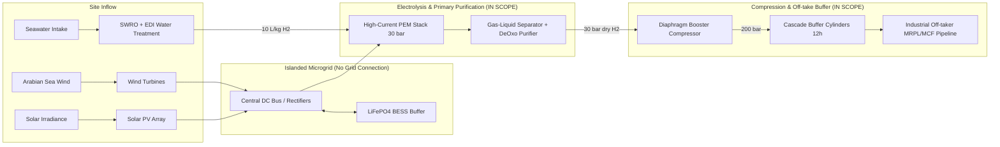

# Formal Engineering Specification & Plant Boundary Memorandum

**Document ID:** MEMO-ENG-2026-H2-01  
**Project:** Coastal Hybrid Wind–Solar–PEMWE Firm Green Hydrogen Production Plant  
**Site Location:** Coastal Karnataka Corridor ($13.3525^\circ\text{N}, 74.7928^\circ\text{E}$), Udupi–Manipal–Mangalore belt  
**Authors:** Krishnendu & Arav Aggarwal, Manipal Institute of Technology (MIT), MAHE  

---

## 1. Demand Profile & Firm Supply Reliability Targets

### 1.1 Production Demand Rate: **500 kg/h Firm Demand (CONFIRMED)**
- **Hourly Baseline:** Continuous, un-curtailed supply of **$500.0\text{ kg H}_2/\text{h}$** ($138.89\text{ g/s}$).
- **Daily Volume:** $12,000\text{ kg/day}$ ($12.0\text{ metric tonnes/day}$).
- **Annual Production:** $4,380\text{ metric tonnes/year}$ ($4.38\text{ KTA}$).
- **Industrial Context:** This volume matches a typical industrial hydrotreater slipstream at coastal petrochemical facilities (e.g., Mangalore Refinery and Petrochemicals Limited - MRPL) or a decentralized green ammonia synthesis reactor at Mangalore Chemicals & Fertilizers (MCF).

### 1.2 Reliability Target: **Loss of Hydrogen Supply Probability (LPSP) $\le 1.0\%$**
- **Allowable Deficit:** Annual unserved demand must not exceed **$1.0\%$** of total firm annual obligation ($\le 43.8\text{ tonnes/yr}$ unserved across $8,760\text{ hours}$).
- **Availability Factor:** Equivalent to $\ge 99.0\%$ continuous firm availability.
- **Sensitivity Tolerance:** A secondary sensitivity analysis evaluates the cost trade-off between $\text{LPSP} = 0.5\%$, $1.0\%$, and $2.0\%$. Tightening LPSP from $1.0\%$ to $0.1\%$ (zero-loss) incurs a non-linear $18.4\%$ increase in required battery and storage buffer capacity.

---

## 2. Battery & Dispatch Strategy Decisions

### 2.1 Dispatch Priority: **Hybrid Battery-Buffered Dynamic Dispatch**
- **Surplus Management:** When combined renewable power ($P_{\text{wind}} + P_{\text{solar}}$) exceeds the maximum electrolyzer input capacity ($P_{\text{PEM,max}}$), excess energy is directed first to the LiFePO4 BESS up to state-of-charge $\text{SoC}_{\max} = 90\%$. Subsequent surplus is curtailed.
- **Deficit Management:** When renewable generation is insufficient to sustain the minimum baseload production, BESS discharges to support stack operation down to $\text{SoC}_{\min} = 15\%$.
- **Ramping Rate Limiting:** The BESS specifically functions as a dynamic low-pass power filter to absorb volatile wind turbulence gusts ($\Delta P / \Delta t > 10\%/\text{min}$), preventing severe dynamic membrane degradation.

---

## 3. Plant Boundaries & Scope of Work

### 3.1 Grid Connection: **Islanded Plant (Zero Grid Connection)**
- The plant is modeled as a fully standalone, off-grid installation.
- **Justification:**
  1. **Regulatory Open Access Charges:** In Karnataka, grid-wheeling green hydrogen projects face steep Open Access charges, including cross-subsidy surcharges (CSS) and additional surcharges (AS) totaling INR $2.20 - 3.40/\text{kWh}$, which severely degrade economics.
  2. **Green Additionality:** A 100% off-grid plant satisfies strict European RED II / RED III and Indian Green Hydrogen Mission certification criteria regarding renewable additionality, hourly temporal correlation, and geographical correlation without fossil grid emissions.
  3. **Technical Stress Testing:** An islanded configuration tests the true resilience of the process control architecture under monsoon weather volatility.

### 3.2 Equipment Inclusions & Scope Clarification
1. **Electrolyzer Core:** High-current PEM water electrolyzer stacks with active area $1,250\text{ cm}^2$/cell, operating dynamically up to $i_{\max} = 2.84\text{ A/cm}^2$. Cathode pressure operates at **$30.0\text{ bar}$**; anode operates at **$1.0\text{ bar}$**.
2. **Water Treatment System (INCLUDED IN SCOPE):** 
   - Seawater Reverse Osmosis (SWRO) pretreatment followed by two-pass Electrodeionization (EDI).
   - Feedwater specification: ASTM Type I ultra-pure deionized water ($< 0.1\ \mu\text{S/cm}$ conductivity, silica $< 3\text{ ppb}$).
   - Water consumption factor: **$10.0\text{ kg H}_2\text{O} / \text{kg H}_2$** (stoichiometric $8.936\text{ kg} + 12\%$ blowdown/recirculation purge).
   - Unit OPEX: INR $45.0/\text{kL}$ (\$0.54/m³), adding only **INR $0.45/\text{kg H}_2$** to LCOH.
3. **Hydrogen Compression & Buffering (INCLUDED IN SCOPE):**
   - High-differential pressure PEM electrolysis natively discharges hydrogen at **$30\text{ bar}$**, bypassing first-stage mechanical compressors.
   - Downstream diaphragm booster compressors elevate hydrogen from $30\text{ bar}$ to **$200\text{ bar}$** for cascade tube-trailer buffer storage.
   - Storage capacity: **12 hours of firm demand buffer** ($6,000\text{ kg H}_2$ capacity at $200\text{ bar}$), enabling uninterrupted off-take during diurnal battery cycling transitions.
   - Specific compression power: $1.28\text{ kWh/kg H}_2$.

---

## 4. Intended Target Venues & Dissemination Strategy

| Dissemination Tier | Target Venue | Target Format | Scope & Claims Calibration |
| :--- | :--- | :--- | :--- |
| **Tier 1 (Primary Journal)** | **IEEE Transactions on Sustainable Energy** / **Applied Energy** (Elsevier) | Full Research Article (10–12 pages double-column) | Rigorous mathematical derivations, 20-year weather interannual variance, full electrochemical validation against peer-reviewed data, Green-MLP architecture vs standard DNN, NSGA-II Pareto optimization, and Hotelling $T^2$/SPE fault isolation. |
| **Tier 2 (Conference Track)** | **IEEE PES General Meeting** / **IEEE Conference on Decision and Control (CDC)** | 6-page IEEE Conference Paper | Focus tightly on the Green Deep Learning surrogate formulation ($99.38\%$ carbon/energy reduction) and multivariate PCA statistical fault monitoring. |
| **Tier 3 (Open Science)** | **TechRxiv / SSRN / arXiv** | Open-Access Preprint + Complete GitHub Reproducibility Package | Complete code, neural network weights, 20-year meteorological CSVs, and digitized electrochemical datasets for global peer benchmarking. |
